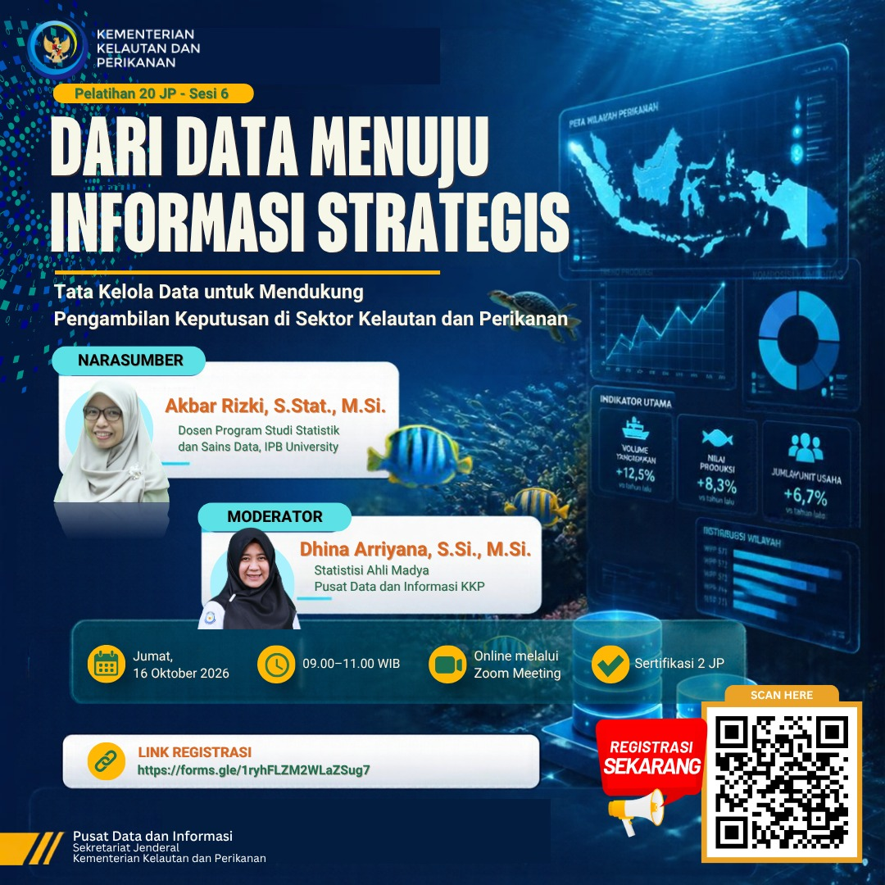

# 🌊 Dari Data Menuju Informasi Strategis

### Tata Kelola Data untuk Mendukung Pengambilan Keputusan di Sektor Kelautan dan Perikanan

**Pelatihan Pengembangan Kompetensi 20 JP — Sesi 6**  
Diselenggarakan oleh **Pusat Data dan Informasi, Kementerian Kelautan dan Perikanan Republik Indonesia**

## 📖 Tentang Kegiatan

Data bukan sekadar kumpulan angka. Dengan tata kelola yang tepat, data dapat diolah menjadi **informasi strategis** untuk mendukung perumusan kebijakan dan pengambilan keputusan yang lebih **akurat, efektif, dan berkelanjutan** di sektor kelautan dan perikanan.

Pelatihan ini mengajak peserta meningkatkan literasi data, memahami pentingnya kualitas dan tata kelola data, serta mengenali bagaimana data dimanfaatkan dalam proses **pengambilan keputusan berbasis bukti (*evidence-based decision making*)**.

## 🗓️ Informasi Pelatihan

| Informasi | Keterangan |
|---|---|
| **Kegiatan** | Pelatihan Pengembangan Kompetensi 20 JP – Sesi 6 |
| **Hari, tanggal** | Jumat, 16 Oktober 2026 |
| **Waktu** | 09.00–11.00 WIB |
| **Media** | Online melalui Zoom Meeting |
| **Penyelenggara** | Pusat Data dan Informasi, Kementerian Kelautan dan Perikanan RI |
| **Sertifikasi** | 2 JP |

## 🎤 Narasumber dan Moderator

**Narasumber — Akbar Rizki, S.Stat., M.Si.**  
Dosen Program Studi Statistika dan Sains Data, IPB University.

**Moderator — Dhina Arriyana, S.Si., M.Si.**  
Statistisi Ahli Madya, Pusat Data dan Informasi KKP.

## 🎯 Fokus Pembahasan

- Peran data sebagai fondasi informasi strategis dan kebijakan publik.
- Pentingnya tata kelola dan kualitas data di sektor kelautan dan perikanan.
- Transformasi data mentah menjadi informasi yang relevan dan mudah dipahami.
- Pemanfaatan informasi untuk mendukung keputusan berbasis bukti.
- Penguatan literasi data dan budaya pengambilan keputusan berbasis data.

> **Data yang dikelola dengan baik adalah fondasi keputusan yang berkualitas.**

## 🔗 Registrasi

**[Daftar melalui Google Forms](https://forms.gle/1ryhFLZM2WLaZSug7)**

Pelatihan dilaksanakan secara daring melalui Zoom Meeting. Informasi akses kegiatan mengikuti ketentuan penyelenggara.

## 👥 Sasaran Peserta

Kegiatan ini relevan bagi ASN dan pegawai di lingkungan KKP, dinas kelautan dan perikanan daerah, kementerian/lembaga lain, akademisi, mahasiswa, serta pemerhati pengelolaan data.

## 🏛️ Penyelenggara

**Pusat Data dan Informasi**  
Sekretariat Jenderal  
Kementerian Kelautan dan Perikanan Republik Indonesia

---

**Topik:** `Data Governance` · `Data Analytics` · `Literasi Data` · `Evidence-Based Decision Making` · `Transformasi Digital` · `Blue Economy`

Informasi kegiatan disusun berdasarkan poster dan publikasi pelatihan tanggal 16 Oktober 2026.
